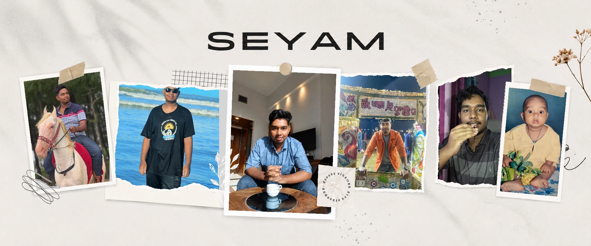

<!-- Banner -->

 

<!-- Dynamic Typing Header -->
<h1>
  
</h1>

  <b>Computer Science & Engineering Student</b> at <b>Bangladesh Army University of Science and Technology (BAUST)</b> 
  Passionate about bridging <b>Machine Learning</b>, <b>Edge Computing</b>, and <b>Embedded Systems</b>.

<!-- Social Links Badges -->

  
  
  
  
  
  

---

### 👨‍💻 About Me

- 🎓 Undergraduate student in **Computer Science and Engineering (CSE)** at **BAUST**.
- 🔬 Researching **Edge-Enabled Deep Learning** and **Predictive Maintenance for Industrial IoT**.
- 🎥 Content Creator on YouTube: **[DataChain](https://www.youtube.com/@DataChain-seyam)** — delivering quality Bengali-language programming and computer science tutorials.
- 💡 Interested in: Edge AI, Computer Vision, Embedded IoT, and Deep Learning Optimization.
- ⚡ Fun fact: I love tinkering with microcontrollers and optimizing neural nets to run on low-power edge chips.

---

### 📚 Research & Publications

<table>
  <tr>
    <td>
      <h3>📑 Edge-Enabled Deep Learning Framework for Predictive Maintenance in Industrial IoT Environments</h3>
      

        🎯 <b>Status:</b> Accepted & Presented at <b>iCONEECT 2026</b> 
        🏛️ <b>Venue:</b> Premier University, Chattogram (Technical Co-sponsor: <b>IEEE Bangladesh Section</b>) 
        🔍 <b>Domain:</b> Industrial IoT (IIoT), Edge Artificial Intelligence, Deep Learning, Sensor Fault Diagnostics & Prognostics.
      

    </td>
  </tr>
</table>

---

### 🛠️ What I'm Building & Learning

- 🤖 **ESP32-CAM Face Recognition Security System**  
  *Embedded systems sessional project bringing localized biometric authentication onto low-power hardware.*
- 📈 **[AI-ML-Learning](https://github.com/mdseyamali2005/AI-ML-Learning)**  
  *Open-source repository documenting hands-on workflows in NumPy, Pandas, exploratory data analysis (EDA), and data visualization.*
- 🌐 **Modern Personal Portfolio**  
  *High-performance web portfolio built using **Next.js**, **Sanity CMS**, and **Tailwind CSS**.*

---

### 💻 Tech Stack & Tools

#### 🚀 Programming Languages

  
  
  
  
  

#### 🧠 Data Science, AI/ML & Embedded Hardware

  
  
  
  

#### 🌐 Web Development & DevOps

  
  
  
  

---

### 📊 GitHub Activity & Metrics

  
  

  

---

### 📫 Let's Connect!

I am always thrilled to collaborate on **AI/ML**, **Edge Computing**, and **Embedded Systems** projects or discuss academic research.

- 💬 Let's chat via [LinkedIn](https://www.linkedin.com/in/md-seyam-ali/) or [X](https://x.com/md_seyam_ali)
- 🌐 Explore more at **[mdseyamali.me](https://mdseyamali.me/)**
- 📧 Reach out for collaborations or tech discussions!

   
  Designed with ❤️ by Md Seyam Ali • Powered by GitHub Markdown

